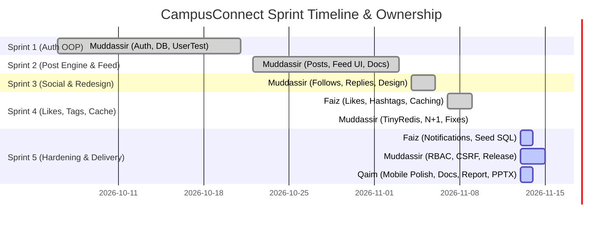

# Team Contribution Matrix & Git Audit

> **Honesty & Verification Notice**: This matrix is constructed directly from the verifiable Git repository commit history (`git log --all`). It documents the exact division of labor across all 5 Agile sprints for project **CampusConnect** (`ASPM-PROJECT-`), Section **BCS-7A**, Group Code **AIR**. Counts below were verified against main `8f516cf` (PR #9 merged 13 Nov 2026) plus the unmerged Sprint 5 branches. Main now has 34 commits total.

---

## 1. Executive Summary & Author Statistics

| Team Member | Git Author Identity | Primary Role / Ownership | Commit Count (Sprints 1–4) | Commit Count (Sprint 5) | Total Commits |
|---|---|---|:---:|:---:|:---:|
| **Muddassir** | `muddassir1935` | Technical Lead / Core Backend & Architecture (Sprints 1–3, Sprint 4 Fixes, Sprint 5 RBAC) | 25 | 2 on main (+1 RBAC branch) | 27 on main |
| **Faiz Hussain** | `FaizHussain1912` | Backend & Testing Lead (Sprint 4 Core Likes/Hashtags/Cache, Sprint 5 Notifications) | 4 | 3 | 7 |
| **Qaim** | `Qaim` | Frontend & Documentation Lead (Sprint 5 Responsive Polish, Docs Suite, Deliverables) | 0 | 4 (branch, PR #10) | 4 (pending merge) |

---

## 2. Sprint-by-Sprint Division of Labor

### Sprint 1: Authentication OOP Foundation (WBS 1.0)
- **Period**: 6 Oct 2026 – 21 Oct 2026 (Merged 2 Nov 2026, `b2a72b4`)
- **Primary Contributor**: Muddassir (100% of commits)
- **Key Deliverables**:
  - `Database.php` Singleton connection with SQLite test fallback (`583868d`)
  - `User.php` domain model with `password_hash()` and strong password policy (`9c9525d`)
  - `Auth.php` session fixation defense & `logout.php` (`c60178e`)
  - `tests/UserTest.php` 12-case automated test suite (`5236145`), extended to 17 cases by Sprint 1 close (`9c9525d`)

### Sprint 2: Core Post Engine, Feed UI & Soft-Delete (WBS 2.0)
- **Period**: 22 Oct 2026 – 3 Nov 2026 (PRs #1, #2, #3)
- **Primary Contributor**: Muddassir (100% of commits)
- **Key Deliverables**:
  - `Post.php` model, CRUD operations, 280-char validation, pagination (`50dd377`)
  - Live timeline feed UI, compose box, character counter, soft-delete via `deleted_at` (`4137b73`)
  - `tests/PostTest.php` 22-case automated test suite (`50dd377`), extended to 29 cases by Sprint 2 close
  - Documentation increment, WBS mapping, UML Class Diagram & ERD (`b59c5ae`)

### Sprint 3: Social Graph, Profiles, DB Sessions & Design System (WBS 3.0)
- **Period**: 4 Nov 2026 – 6 Nov 2026 (PRs #4, #5, #6, #7)
- **Primary Contributor**: Muddassir (100% of commits)
- **Key Deliverables**:
  - `Follow.php`, `Reply.php`, `Bookmark.php`, personalized feed queries (`6cbe7d4`)
  - `DbSessionHandler.php` for database-backed session management (`6cbe7d4`)
  - 3-column layout, user profile page, follower/following modals, explore page (`0c09dab`)
  - Product-scale design system, Interlocked CC brand mark, cover style presets (`5572167`, `9bbf23e`)
  - `tests/SocialTest.php` (49 tests) and `tests/SessionTest.php` (9 tests) (`6cbe7d4`)
  - Documentation increment & Sprint 1–2 retro notes (`78e4ad1`)

### Sprint 4: Engagement, Hashtags, Redis Caching & Benchmarking (WBS 4.0)
- **Period**: 7 Nov 2026 – 9 Nov 2026 (PR #8 & `feature/sprint-4-core`)
- **Contributors**: Faiz Hussain & Muddassir
  - **Faiz Hussain** (`3ac38d4`, `914bfde`, `4ddc779`, `d7f1938`):
    - `Like.php` model, idempotent toggle, AJAX endpoint `like_action.php`, heart SVG UI (`3ac38d4`)
    - `Hashtag.php` regex parser, indexing, explore tag filter, Trending Topics widget (`3ac38d4`)
    - `Cache.php` caching layer foundation (`3ac38d4`)
    - Case-insensitive hashtag link routing and role-string compatibility (`914bfde`)
    - `tests/Sprint4Test.php` and initial benchmark script (`4ddc779`)
  - **Muddassir** (`56415ef`, `d1e4400`):
    - Sprint 4 verification fixes & regression tests (`56415ef`)
    - Pure-PHP `TinyRedisClient.php` socket client implementation (`56415ef`)
    - Feed cache TTL synchronization, counter caching, invalidation hooks (`56415ef`)
    - Benchmark SVG dashboard & N+1 query audit report (`docs/n-plus-1-audit-sprint4.md`)

### Sprint 5: Hardening, Turnkey Deployment & Agile Project Deliverables (WBS 5.0)
- **Period**: 13 Nov 2026 – 15 Nov 2026
- **Contributors**: Qaim, Faiz Hussain, Muddassir
  - **Qaim** (Branch `feature/sprint-5-docs`):
    - **Responsive Polish & Micro-interactions**: Viewport audit at 360px and tablet widths, overflow bug fixes, tactile button press feedback, like animation (`8ae9bd7`).
    - **Documentation Suite**:
      - `docs/sprint-5-srs-increment.md` (SRS finalization)
      - `docs/USER_MANUAL.md` (Comprehensive end-user manual)
      - `docs/ADMIN_MANUAL.md` (Society & system administration guide)
      - `docs/CONTRIBUTION.md` (Verifiable Git contribution audit)
      - `docs/MEETINGS.md` (Official meeting minutes)
      - Sprint 5 Review and Retrospective notes
    - **Final Academic Deliverables**:
      - Agile Presentation Deck (`AIR_Presentation.pptx`, generated by `scripts/generate_pptx.py`)
      - Comprehensive Technical Project Report (`AIR_Report.pdf`, generated by `scripts/generate_report.py`)
  - **Faiz Hussain** (Branch `feature/sprint-5-notifications`, merged as PR #9, main `8f516cf`):
    - `Notification.php` model, notifications center page, header unread badge (`3933e4d`).
    - Notification triggers for follow, reply, and like events (`3933e4d`).
    - `db/seed.sql` realistic university dataset (`4a79114`).
    - `docs/DEPLOYMENT.md` 5-minute XAMPP deployment guide (`4a79114`).
    - `tests/NotificationTest.php` automated test suite (`2500727`).
  - **Muddassir & Muse** (Branch `feature/sprint-5-rbac`, plus PR #9 review fixes):
    - Role-Based Access Control (`student`, `society_admin`, `system_admin`) — core built (`748f65d`).
    - Central permissions matrix, society announcement channels (in progress), admin moderation panel (in progress).
    - Security hardening: session idle timeout built; CSRF token validation and login rate limiting in progress.
    - PR #9 review fixes on Faiz's branch (`af641f3`): notifications table in `db/schema.sql`, auth redirect order, `create()` error handling, `rowCount()` truth — suite 181/181.
    - Final release verification, tagging, and zip packaging (`AIR_WorkingSoftware.zip`, regenerated from merged main on 15 Nov).

---

## 3. Verifiable Git Commit Log Audit

Below is the chronological commit register from the repository:

| Hash | Author | Date | Subject |
|---|---|---|---|
| `8f516cf` | muddassir1935 | 2026-11-13 | Merge pull request #9 from muddassir1935/feature/sprint-5-notifications |
| `af641f3` | muddassir1935 | 2026-11-13 | fix(sprint-5): review fixes — notifications table in schema.sql, auth redirect order, create() error handling, rowCount() truth (Muse, on Faiz's branch) |
| `5714c7f` | Qaim | 2026-11-13 | build(deliverables): Finalize deliverables for Section BCS-7A & Group Code AIR (branch `feature/sprint-5-docs`, PR #10) |
| `4ea2c53` | Qaim | 2026-11-13 | build(deliverables): Add Agile presentation deck, comprehensive technical report, figures & release packaging scripts (branch `feature/sprint-5-docs`, PR #10) |
| `bb448d1` | Qaim | 2026-11-13 | docs(sprint-5): Comprehensive documentation suite (SRS increment, User & Admin manuals, Contribution matrix, Meeting minutes, Retro) (branch `feature/sprint-5-docs`, PR #10) |
| `8ae9bd7` | Qaim | 2026-11-13 | feat(ui): Responsive mobile polish (360px/tablet), overflow fixes & micro-interactions (branch `feature/sprint-5-docs`, PR #10) |
| `2500727` | FaizHussain1912 | 2026-11-13 | test(notifications): unit test suite for notification model, unread counters, and triggers |
| `4a79114` | FaizHussain1912 | 2026-11-13 | feat(seed): university demo dataset and 5-minute deployment guide (Problem 12) |
| `3933e4d` | FaizHussain1912 | 2026-11-13 | feat(notifications): in-app notifications model, triggers, center page, and header unread badge (WBS 5.x) |
| `748f65d` | muddassir1935 | 2026-11-12 | feat(rbac): central RBAC core — Authorization permissions, new role names, role refresh, idle timeout (Sprint 5) (branch `feature/sprint-5-rbac`, unmerged) |
| `d1e4400` | muddassir1935 | 2026-11-09 | Merge pull request #8 from muddassir1935/feature/sprint-4-fixes |
| `56415ef` | muddassir1935 | 2026-11-09 | fix(sprint-4): verification fixes — TinyRedisClient + Cache chain, hashtag entity rendering bug, viewer like state, bookmarks like counts, bound viewer-id params, feed cache TTL/invalidation, benchmark SVG dashboard, N+1 audit, regression tests |
| `d7f1938` | FaizHussain1912 | 2026-11-09 | Merge branch 'feature/sprint-4-core' into main (Sprint 4 Complete) |
| `4ddc779` | FaizHussain1912 | 2026-11-09 | docs(sprint-4): UML/ERD increment, review/retro notes, benchmark script, and UI polish (WBS 4.1-4.5) |
| `914bfde` | FaizHussain1912 | 2026-11-09 | fix(sprint-4-core): Case-insensitive hashtag link routing and role-string compatibility in Post delete |
| `3ac38d4` | FaizHussain1912 | 2026-11-09 | feat(sprint-4-core): Likes, Hashtags system, and Redis/Memory cache layer (WBS 4.1, 4.2, 4.3) |
| `4076dda` | muddassir1935 | 2026-11-06 | Merge pull request #7 from muddassir1935/feature/sprint-3-docs |
| `78e4ad1` | muddassir1935 | 2026-11-06 | docs(sprint-3): SRS increment, UML/ERD, WBS mapping, Sprint 3 review/retro (WBS 3.6) |
| `7fe4dda` | muddassir1935 | 2026-11-05 | Merge pull request #6 from muddassir1935/feature/sprint-3-design |
| `46b679c` | muddassir1935 | 2026-11-05 | Merge pull request #5 from muddassir1935/feature/sprint-3-ui |
| `36315f9` | muddassir1935 | 2026-11-05 | Merge pull request #4 from muddassir1935/feature/sprint-3-core |
| `9bbf23e` | muddassir1935 | 2026-11-05 | feat(sprint-3-design): Design system CSS + per-user cover styles backend (cover_style column, migrations, tests) |
| `5572167` | muddassir1935 | 2026-11-05 | style(sprint-3-design): Premium product redesign — flat divider feed, brand character, cover picker UI, Interlocked CC logo |
| `0c09dab` | muddassir1935 | 2026-11-05 | feat(sprint-3-ui): Profiles, explore, bookmarks, 3-column layout (WBS 3.3, 3.4) |
| `6cbe7d4` | muddassir1935 | 2026-11-05 | feat(sprint-3-core): Follows, replies, bookmarks, search, DB sessions (WBS 3.2, 3.3, 3.4) |
| `3e4b292` | muddassir1935 | 2026-11-03 | Merge pull request #3: Sprint 2 Documentation (WBS 2.6) |
| `b59c5ae` | muddassir1935 | 2026-11-03 | docs(sprint-2): SRS increment, UML class diagram + ERD, WBS mapping, Sprint 1-2 review/retro (WBS 2.6) |
| `f496a09` | muddassir1935 | 2026-11-02 | Merge pull request #2: Sprint 2 UI — live feed, compose, detail, soft-delete |
| `4137b73` | muddassir1935 | 2026-11-02 | feat(feed): Wire live timeline UI, compose box, post detail page, soft-delete (WBS 2.3.1, 2.3.4, 2.3.6, 2.4.2) |
| `cc7c1eb` | muddassir1935 | 2026-11-02 | Merge pull request #1: Sprint 2 Core Post Engine (WBS 2.2, 2.3, 2.4) |
| `b2a72b4` | muddassir1935 | 2026-11-02 | Merge branch 'feature/sprint-1-auth-oop' into main (Sprint 1 Complete) |
| `50dd377` | muddassir1935 | 2026-11-02 | feat(post): Implement posts database schema, Post model, PostController, and 22 unit tests (WBS 2.2, 2.3) |
| `c60178e` | muddassir1935 | 2026-10-21 | feat(auth): Enhance session security, add logout handler, and polish UI & unit tests |
| `3792a06` | muddassir1935 | 2026-10-07 | test: remove emojis from test CLI output |
| `9c9525d` | muddassir1935 | 2026-10-07 | feat(auth): Implement strong password validation and 5 additional unit tests |
| `5236145` | muddassir1935 | 2026-10-07 | test: Implement comprehensive 12-case unit test suite for Auth module |
| `583868d` | muddassir1935 | 2026-10-07 | feat: Add zero-config SQLite fallback for testing and update gitignore |
| `5e05527` | muddassir1935 | 2026-10-06 | feat: Implement Sprint 1 Auth OOP foundation & Unit Test script |
| `09b9fb7` | muddassir1935 | 2026-10-06 | Initial commit: Setup project rules and context |
