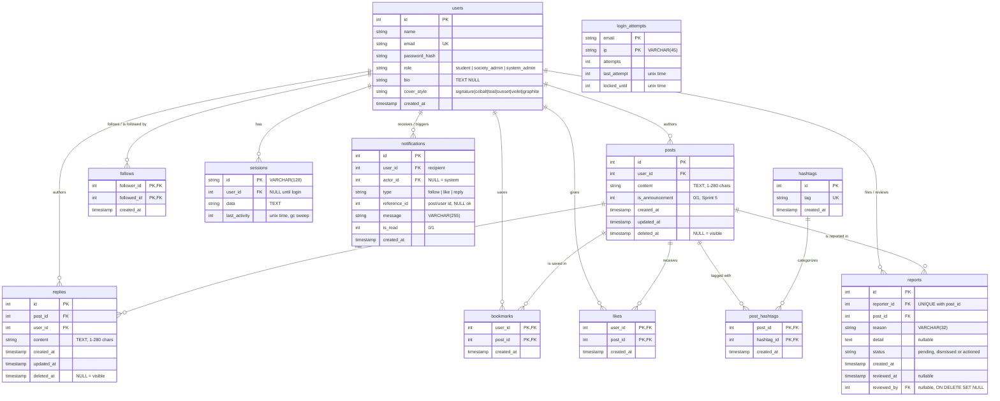

# UML Class Diagram and ERD (Sprints 1–5, as built)

Diagrams are drawn from the code in `main` as of 15 Nov 2026 (after the
reporting/moderation PR #15 and the audit fixes). The class diagram's members
and signatures were generated from the classes with PHP reflection, so they
match the files exactly (`static` = static member, `-` private, `+` public);
nothing here is aspirational.

## Class diagram

```mermaid
classDiagram
    class Database {
        -static instance
        -connection
        -driver
        -host
        -db
        -user
        -pass
        -__construct()
        +static getInstance()
        +getConnection()
        +getDriver()
        +isFallback()
    }
    class User {
        +COVER_STYLES = ['signature','cobalt','teal','sunset','violet','graphite']
        +DEFAULT_COVER_STYLE = 'signature'
        -db
        +__construct(dbConnection)
        +static normalizeCoverStyle(style) string
        +static cleanName(name) string
        +register(name, email, password)
        +static isCampusEmail(email) bool
        +static isValidPassword(password) bool
        +changePassword(userId, currentPassword, newPassword) bool
        +resetPassword(userId, newPassword) bool
        +static generateTemporaryPassword() string
        -setPasswordHash(userId, newPassword) bool
        +verifyPassword(email, password)
        +getById(userId)
        +updateProfile(userId, name, bio, coverStyle) bool
        -static flushFeedCache() void
        +listUsers(search, limit, offset) array
        +countUsers(search) int
        +setRole(userId, role) bool
        +countSystemAdmins() int
        +searchUsers(query, excludeUserId, limit) array
    }
    class Auth {
        +IDLE_TIMEOUT_SECONDS = 1800
        -static dbSessionHandlerRegistered bool
        -static dbSessionHandler DbSessionHandler|null
        -static roleRefreshed bool
        +static hardenSessionCookie() void
        -static startSession()
        -static enforceIdleTimeout() void
        +static registerDbSessionHandler() void
        +static login(userData)
        +static logout()
        +static isLoggedIn()
        +static user()
        +static can(permission) bool
        -static refreshRoleFromDatabase() void
    }
    class Authorization {
        +ROLE_STUDENT = 'student'
        +ROLE_SOCIETY_ADMIN = 'society_admin'
        +ROLE_SYSTEM_ADMIN = 'system_admin'
        +ROLES = ['student','society_admin','system_admin']
        +DISPLAY_LABELS = [3 entries]
        +static normalizeRole(role) string
        +static isValidRole(role) bool
        +static can(role, permission) bool
        +static permissionsFor(role) array
        +static isOfficialRole(role) bool
        +static displayLabel(role) string
    }
    class Csrf {
        -static startSession() void
        +static token() string
        +static rotate() void
        +static field() string
        +static validate(submitted) bool
        +static validatePost() bool
    }
    class LoginRateLimiter {
        +MAX_ATTEMPTS = 5
        +WINDOW_SECONDS = 900
        +LOCK_SECONDS = 900
        -db PDO
        +__construct(db)
        -ensureTable() void
        -clientIp() string
        -key(email, ip) array
        +isLocked(email, ip, now) bool
        +lockRemainingSeconds(email, ip, now) int
        +recordFailure(email, ip, now) void
        +recordSuccess(email, ip) void
        +attemptsInWindow(email, ip, now) int
    }
    class DbSessionHandler {
        -db PDO
        -driver string
        +__construct(dbConnection)
        +open(path, name) bool
        +close() bool
        +read(id) string|false
        +validateId(id) bool
        +updateTimestamp(id, data) bool
        +write(id, data) bool
        +destroy(id) bool
        +gc(maxLifetime) int|false
        +setUserId(sessionId, userId) bool
        +destroySessionsForUser(userId, exceptSessionId) int|false
    }
    class Post {
        +MAX_LENGTH = 280
        +MIN_LENGTH = 1
        -db PDO
        +__construct(dbConnection)
        +validateContent(content) array
        +create(userId, content, isAnnouncement)
        +getById(postId, viewerId)
        +getFeed(limit, offset, viewerId, bypassCache) array
        -attachLiveState(rows, viewerId) array
        +getByUserId(userId, limit, offset, viewerId) array
        +update(postId, userId, newContent) bool
        +delete(postId, userId, canDeleteAny, canDeleteOwn) bool
        +getPersonalizedFeed(userId, limit, offset) array
        +static personalizedCachePrefix(userId) string
        +countPersonalized(userId) int
        +searchPosts(query, limit, offset, viewerId) array
        +countSearch(query) int
        +countByUser(userId) int
        +countAll() int
        +static formatTimeAgo(datetime) string
        +static parseDbTimestamp(datetime)
        +static formatDbDate(datetime, format) string
    }
    class PostController {
        -postModel Post
        -currentUser array|null
        +__construct(postModel, currentUser)
        +handleCreate(content, asAnnouncement) array
        +handleUpdate(postId, newContent) array
        +handleDelete(postId) array
        -can(permission) bool
        +getTimelineFeed(page, limit) array
        +getUserFeed(userId, page, limit) array
        +getPersonalizedTimelineFeed(userId, page, limit) array
        -paginate(page, limit, total, fetch) array
    }
    class Follow {
        -db PDO
        +__construct(dbConnection)
        +follow(followerId, followedId) bool
        +unfollow(followerId, followedId) bool
        +toggle(followerId, followedId) bool|null
        +isFollowing(followerId, followedId) bool
        +getFollowingIds(userId) array
        +countFollowers(userId) int
        +countFollowing(userId) int
        +getFollowers(userId, limit) array
        +getFollowing(userId, limit) array
        +getSuggestions(userId, limit) array
    }
    class Reply {
        +MAX_LENGTH = 280
        +MIN_LENGTH = 1
        -db PDO
        +__construct(dbConnection)
        +validateContent(content) array
        +create(userId, postId, content)
        +getByPostId(postId, limit, offset) array
        +delete(replyId, userId, canDeleteAny, canDeleteOwn) bool
        +countByPost(postId) int
    }
    class Bookmark {
        -db PDO
        +__construct(dbConnection)
        +add(userId, postId) bool
        +remove(userId, postId) bool
        +toggle(userId, postId) bool|null
        +isBookmarked(userId, postId) bool
        +getBookmarkedPosts(userId, limit, offset) array
        +countByUser(userId) int
    }
    class Like {
        -db PDO
        +__construct(dbConnection)
        +add(userId, postId) bool
        +remove(userId, postId) bool
        +toggle(userId, postId) array|null
        +isLiked(userId, postId) bool
        +countByPost(postId) int
        +countByUser(userId) int
        +getLikedPosts(userId, limit, offset, viewerId) array
        +getUsersWhoLiked(postId, limit) array
    }
    class Hashtag {
        -db PDO
        +__construct(dbConnection)
        +static extractTags(content) array
        +syncPostTags(postId, tags) void
        +static renderHashtagLinks(escapedHtml) string
        +getTrending(limit) array
        +getPostsByTag(tag, viewerId, limit, offset) array
    }
    class Notification {
        +TYPE_FOLLOW = 'follow'
        +TYPE_REPLY = 'reply'
        +TYPE_LIKE = 'like'
        -db PDO
        +__construct(dbConnection)
        +create(userId, type, referenceId, message, actorId)
        -exists(userId, actorId, type, referenceId) bool
        +countUnread(userId) int
        +listUnread(userId, limit) array
        +listAll(userId, limit, offset) array
        +markRead(notificationId, userId) bool
        +markAllRead(userId) bool
        +delete(notificationId, userId) bool
        +formatTimeAgo(datetime) string
    }
    class Report {
        +REASON_SPAM = 'spam'
        +REASON_HARASSMENT = 'harassment'
        +REASON_MISINFORMATION = 'misinformation'
        +REASON_INAPPROPRIATE = 'inappropriate'
        +REASON_VIOLENCE = 'violence'
        +REASON_OTHER = 'other'
        +REASONS = ['spam','harassment','misinformation','inappropriate','violence','other']
        +REASON_LABELS = [6 entries]
        +STATUS_PENDING = 'pending'
        +STATUS_DISMISSED = 'dismissed'
        +STATUS_ACTIONED = 'actioned'
        +MAX_DETAIL_LENGTH = 500
        -db PDO
        +__construct(db)
        +static isValidReason(reason) bool
        +static displayReason(reason) string
        +static validate(reason, detail) array
        +alreadyReported(reporterId, postId) bool
        +getReportedPostIds(reporterId) array
        +create(reporterId, postId, reason, detail) array
        +getById(reportId) array|null
        +countForPost(postId) int
        +countPending() int
        +countReviewed() int
        +listPending(limit, offset) array
        +listReviewed(limit, offset) array
        +review(reportId, action, reviewerId) array
    }
    class Cache {
        -static instance Cache|null
        -redis
        -tiny TinyRedisClient|null
        -backend string
        -memoryCache array
        -__construct()
        +static getInstance() Cache
        -redisHost() string
        -redisPort() int
        -initRedis() void
        +isAvailable() bool
        +getDriverName() string
        +getBackendName() string
        -rawGet(key) string|null
        -rawSet(key, value, ttl) bool
        -rawDel(keys) int
        -rawIncr(key) int|null
        -rawKeysByPrefix(prefix) array
        +get(key)
        +set(key, value, ttl) bool
        +delete(key) bool
        +deleteByPrefix(prefix) void
        +getCounter(key) int|null
        +setCounter(key, value, ttl) void
        +incrementCounter(key) int|null
        +remember(key, ttl, callback)
        +flush() bool
    }
    class TinyRedisClient {
        -host string
        -port int
        -timeout float
        -socket
        -failed bool
        +__construct(host, port, timeout)
        +close() void
        -connect() bool
        -command(args)
        -markBroken() void
        -readReply()
        +ping() bool
        +get(key) string|null
        +set(key, value) bool
        +setex(key, ttl, value) bool
        +del(keys) int
        +incr(key) int|null
        +scan(cursor, pattern, count) array|null
        +keys(pattern) array
    }
    Database --> User : provides PDO
    Database --> Post : provides PDO
    Database --> Follow : provides PDO
    Database --> Reply : provides PDO
    Database --> Bookmark : provides PDO
    Database --> Like : provides PDO
    Database --> Hashtag : provides PDO
    Database --> Notification : provides PDO
    Database --> Report : provides PDO
    Database --> LoginRateLimiter : provides PDO
    Database --> DbSessionHandler : provides PDO
    Auth --> DbSessionHandler : registers as save handler
    Auth --> Authorization : checks permission
    Csrf --> Auth : shares the DB-backed session
    PostController --> Post : uses
    PostController --> Auth : defaults current user
    PostController --> Authorization : enforces post permissions
    Post --> User : author via user_id
    Post --> Hashtag : syncs tags
    Post --> Cache : caches feed rows / invalidates
    User --> Cache : flushes feeds on rename / role change
    Follow --> User : follower / followed via user_id
    Follow --> Cache : clears follower's feed pages
    Reply --> Post : reply to post_id
    Reply --> User : author via user_id
    Bookmark --> Post : saved post_id
    Bookmark --> User : owner via user_id
    Like --> Post : liked post_id
    Like --> User : liker user_id
    Like --> Cache : like counter
    Report --> Post : reported post_id (moderation delete)
    Report --> User : reporter / reviewer via user_id
    Cache --> TinyRedisClient : RESP over socket
    Follow --> Notification : follow trigger
    Like --> Notification : like trigger
    Reply --> Notification : reply trigger
    Notification --> User : recipient & actor via user_id
    Notification --> Post : shares formatTimeAgo
```

Notes:

- `Database` is a Singleton: one PDO connection per request, MySQL first with
  a zero-config SQLite fallback when MySQL is unreachable.
- `Cache` is a Singleton: provides Redis caching with automatic memory fallback.
- `Like` and `Hashtag` follow standard domain model OOP patterns with PDO injection.

## Entity-relationship diagram

