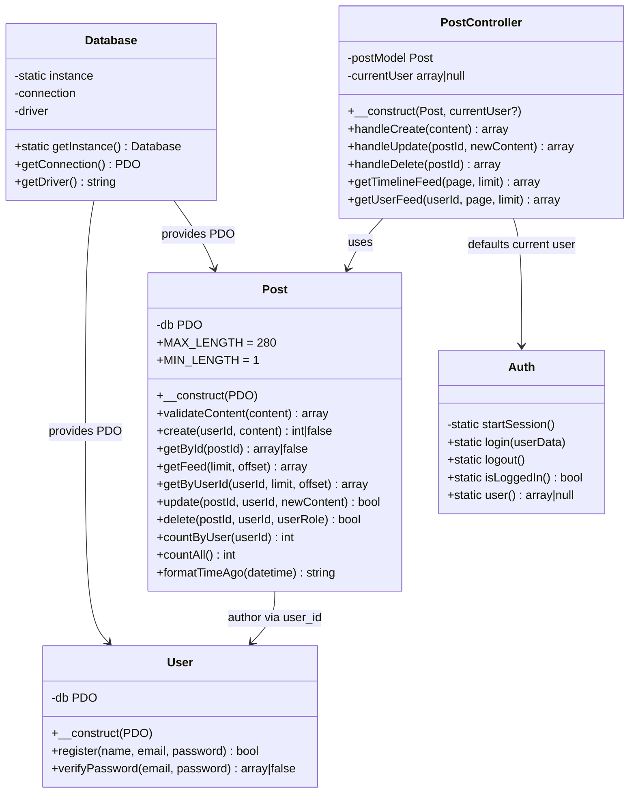
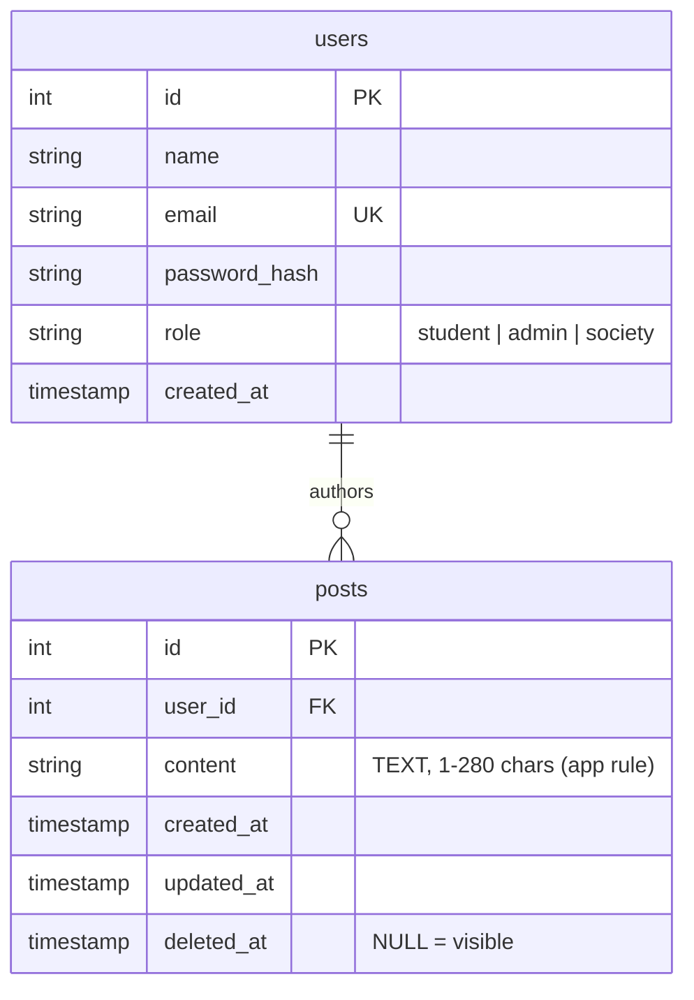

# UML Class Diagram and ERD (Sprints 1–2, as built)

Diagrams are drawn from the code in `main` at Sprint 2 completion
(merge `f496a09`, 2 Nov 2026). Class names, methods and columns below match
the files; nothing here is aspirational.

## Class diagram

Notes:

- `Database` is a Singleton: one PDO connection per request, MySQL first with
  a zero-config SQLite fallback when MySQL is unreachable.
- `PostController` never builds SQL; `Post` never reads `$_SESSION` or
  `$_POST`. The HTTP layer is `index.php`, `post.php` and `post_action.php`,
  which delegate to the controller and redirect (Post/Redirect/Get).
- Authorization lives in the model: `Post::update()` checks ownership,
  `Post::delete()` allows author or admin. The UI only decides which buttons
  to show.

## Entity-relationship diagram

Rules the diagram implies and the code enforces:

- `posts.user_id` → `users.id` ON DELETE CASCADE (MySQL schema; SQLite
  fallback declares the same FK with `PRAGMA foreign_keys = ON`).
- `users.email` is UNIQUE (registration rejects duplicates).
- Soft-delete is a state, not a removal: a row with `deleted_at` set stays in
  the table but is filtered out of every read query.
- Indexes: `idx_posts_user_id (user_id)`, `idx_posts_created_at
  (created_at DESC)` — matching the feed (`ORDER BY created_at DESC, id
  DESC`) and per-user queries.
