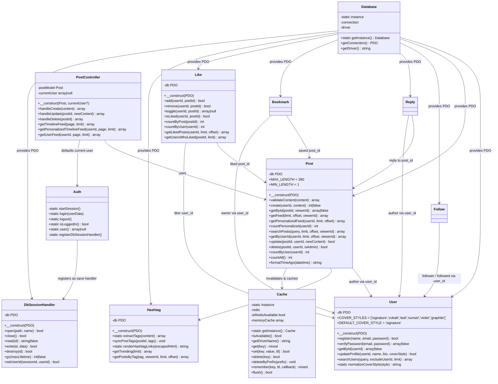
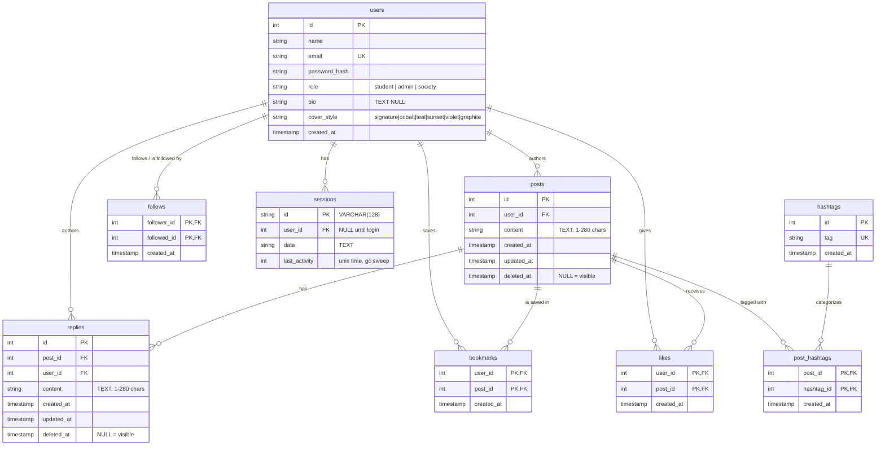

# UML Class Diagram and ERD (Sprints 1–4, as built)

Diagrams are drawn from the code in `main` and `feature/sprint-4-core`
(Sprint 4 completion, 9 Nov 2026). Class names, methods and columns below match
the files; nothing here is aspirational.

## Class diagram

Notes:

- `Database` is a Singleton: one PDO connection per request, MySQL first with
  a zero-config SQLite fallback when MySQL is unreachable.
- `Cache` is a Singleton: provides Redis caching with automatic memory fallback.
- `Like` and `Hashtag` follow standard domain model OOP patterns with PDO injection.

## Entity-relationship diagram

